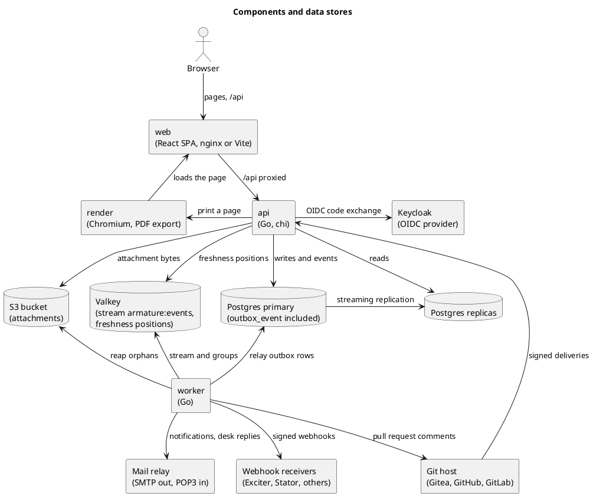
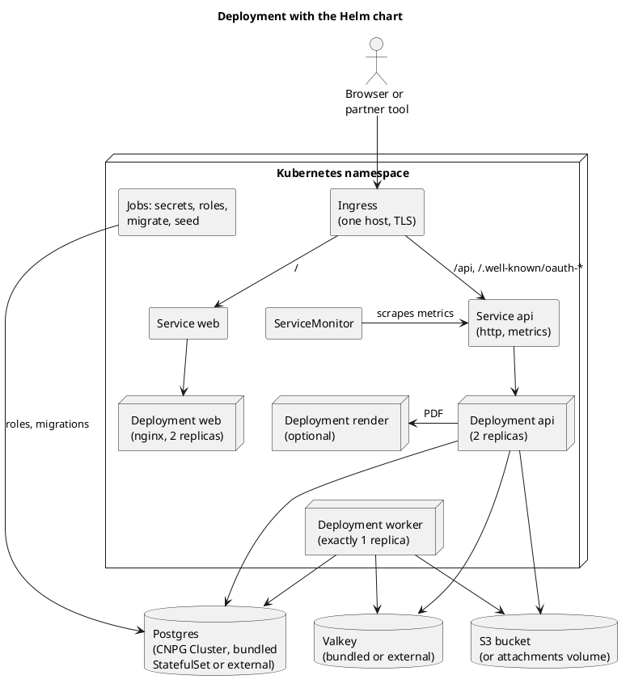
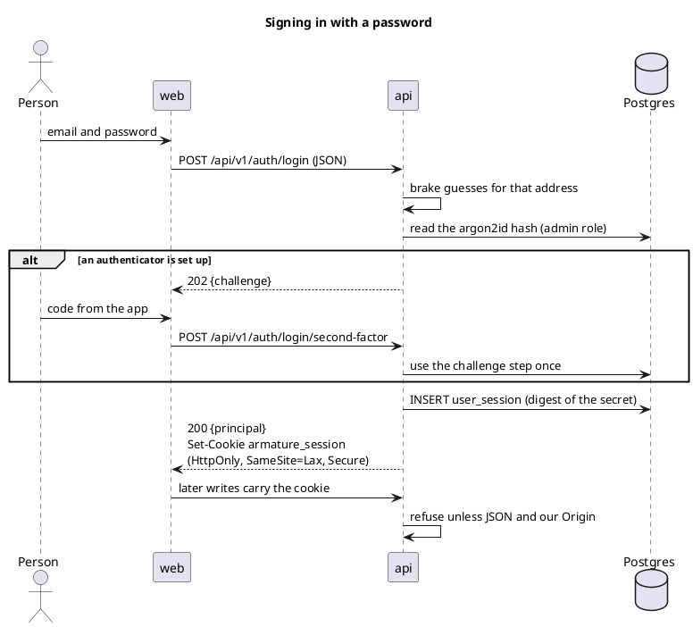
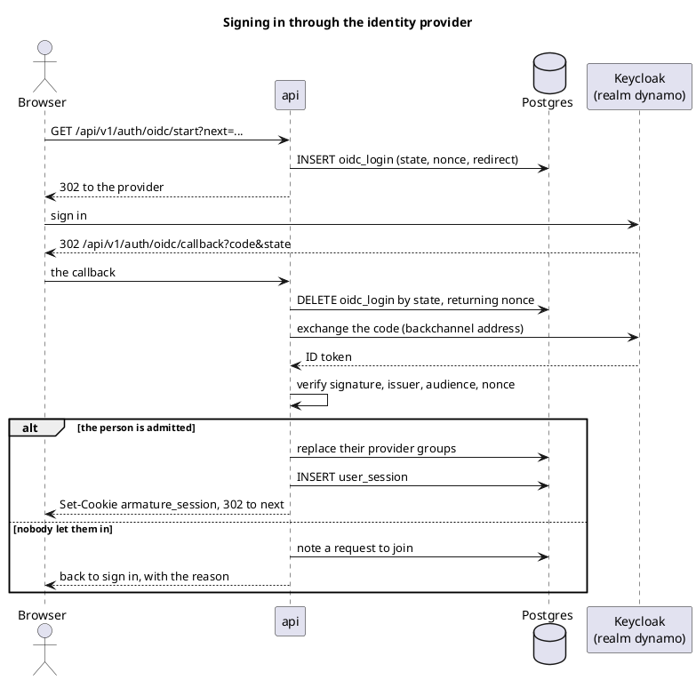
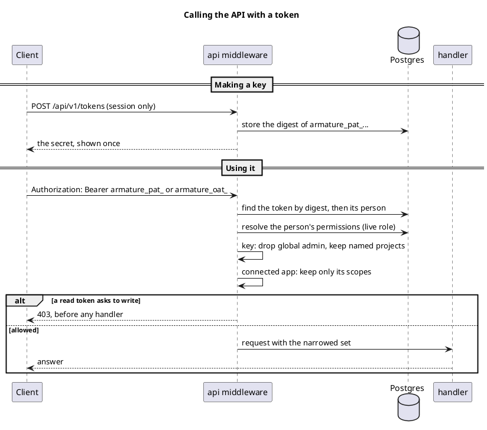
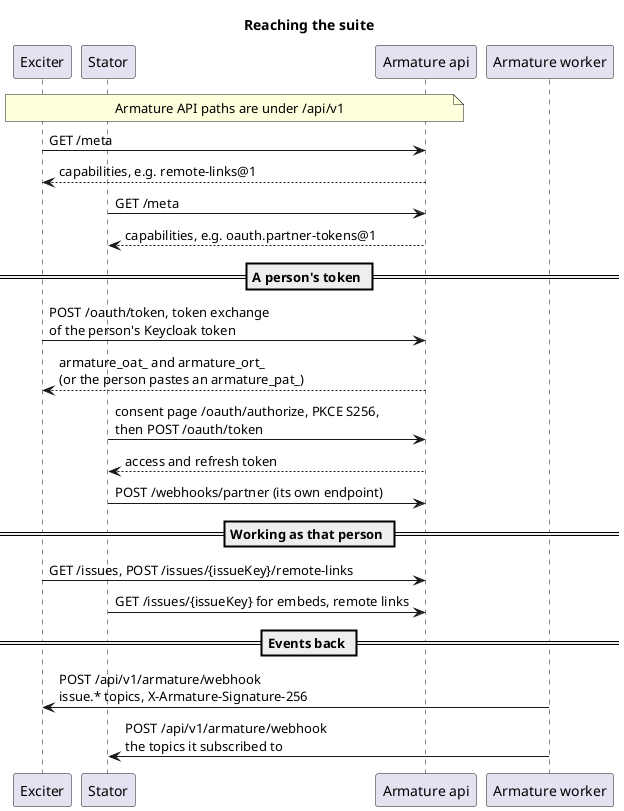
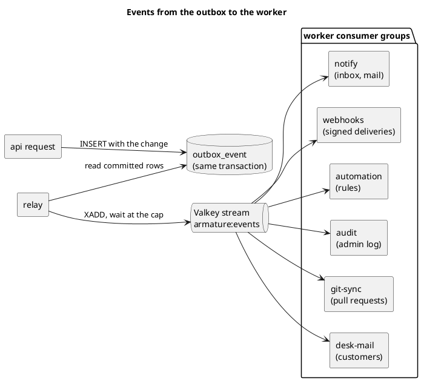
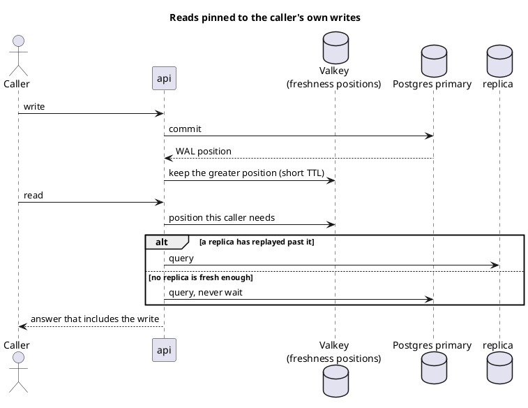
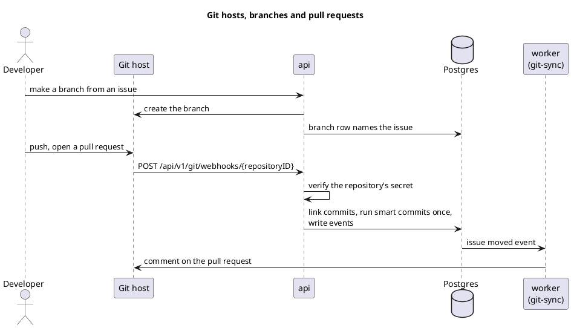

commit: ef402b2acc81a919f2b95e43195d0c98c124ae91
source: docs/decisions.md

How Armature is built, drawn from its decisions document, its README, the compose file, the Helm chart and the code at
this commit. Armature has no architecture document of its own, so each view names what the code calls things.

## Components and data stores

The browser talks to one origin: the web client serves the pages and passes `/api` to the api, a Go server that
writes to the Postgres primary and reads from replicas. Every change writes its event to the `outbox_event` table in
the same transaction, and the worker relays those rows onto a Valkey stream and does everything that should not keep
a request waiting: webhooks, notifications, mail, automation and talking back to git hosts. Attachments live in an S3
bucket, but their bytes always pass through the api, so the database row decides who may read them.

## Deployment with the Helm chart

The chart `deploy/charts/armature` installs the api, the worker, the web client and, when `render.enabled` is set,
the PDF renderer. One Ingress host carries everything: `/api` and the two OAuth `.well-known` documents go to the api
Service, the rest to the web Service, so the session cookie stays first party. The worker is pinned to one replica,
since its stream consumers have no leader election, and metrics stay on a private port that only a ServiceMonitor
scrapes. The compose stack runs the same images beside Keycloak, Gitea, Mailpit and SeaweedFS for development.

## Signing in with a password

A password sign-in posts JSON to `/api/v1/auth/login`; the api brakes guesses by the address guessed at and checks
an argon2id hash read through the admin database role, the only one that reads the secret tables. When the person
has an authenticator, the answer is a challenge and the session opens only at `/auth/login/second-factor`. The session
is a random secret stored as a digest in `user_session` and handed to the browser as the `armature_session` cookie.
There is no CSRF token: a write that rides on the cookie must be JSON, which a cross-site form cannot send, and in
production must come from Armature's own origin.

## Signing in through the identity provider

Single sign-on starts at `/api/v1/auth/oidc/start`, at the installation's one provider, which the suite runs as the
Keycloak realm `dynamo` with a client per tool. The state and nonce are kept in `oidc_login` and consumed on the
callback, so a code and state pair works once. The api reaches Keycloak at its in-network address while asking for the
public one, through `ARMATURE_OIDC_BACKCHANNEL`. Authenticating is not being let in: a person nobody admitted gets a
join request rather than a session, and their provider groups are replaced at every sign-in.

## Calling the API with a token

A request authenticates with `Authorization: Bearer` before the cookie is looked at. A personal access token
(`armature_pat_`) is made from a session only, read-only or full, optionally confined to named projects; a connected
app holds an hour-long access token (`armature_oat_`) from Armature's own OAuth server. Every secret is stored as a
digest. The permission set is built once per request from the person's live role and then narrowed: a key drops what
only a global administrator holds and keeps to its projects, an app keeps only its scopes, and a read token's writes
are refused in middleware before any handler.

## Reaching the suite

Armature calls no partner's API: Exciter and Stator call Armature as a person, and Armature sends them signed webhooks.
Both read `GET /api/v1/meta` first and use a feature only when its capability, such as `remote-links@1`, is listed.
Exciter gets each person's token by trading their Keycloak access token at `/oauth/token`, or the person pastes a
personal access token, and puts a remote link on every issue a requirement traces to. Stator connects through the
consent page with PKCE and makes its own webhook endpoint with `webhooks.partner`; Exciter's endpoint is one an
administrator adds by hand.

## Events from the outbox to the worker

An event is a row in `outbox_event`, written in the transaction that made the change, so no event describes a change
that rolled back. The worker's relay moves committed rows onto the Valkey stream `armature:events` and trims it only
below what every consumer group has acknowledged. Each group acknowledges an event once it is handled; after five
attempts the event is set aside as `event.dead_lettered` in the audit log. Delivery is at least once, so each consumer
is idempotent by the event's id.

## Reads pinned to the caller's own writes

Writes go to the primary and report the write ahead log position they committed at. The api keeps the greatest
position per session or token in Valkey for a few seconds, so a load balancer can send the next request to any api
process. A read then goes to a replica that has replayed past that position, or to the primary, and never waits for
replication: a lagging replica costs latency, never a stale answer about the caller's own change.

## Git hosts, branches and pull requests

A repository is connected to a git host, Gitea, GitHub or GitLab, and the host's webhook posts to
`/api/v1/git/webhooks/{repositoryID}`, proven by the repository's own secret rather than a session. A push links its
commits to issues by key or by a branch made from the issue, and smart commit commands act once. The way back runs on
the worker: when an issue moves, its `git-sync` group comments on the pull requests, so a transition never waits on a
host.

