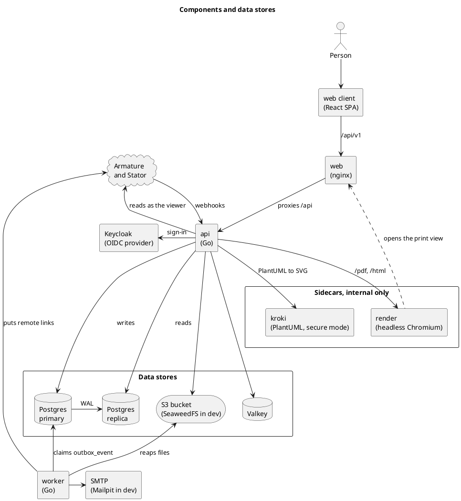
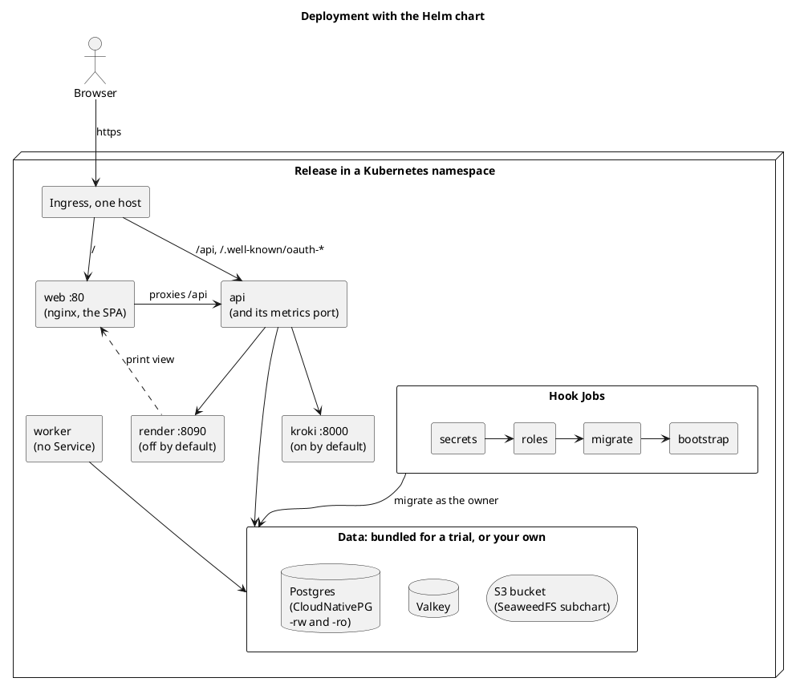
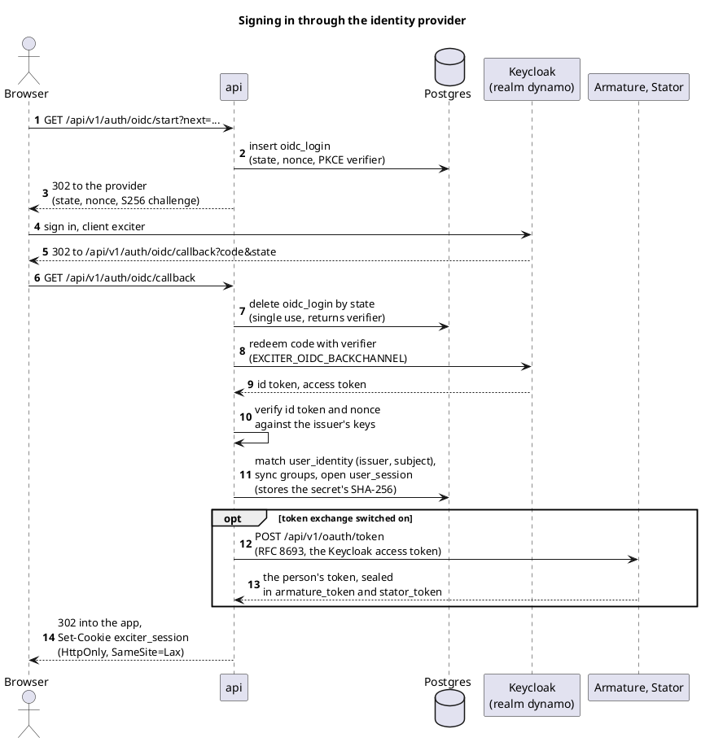
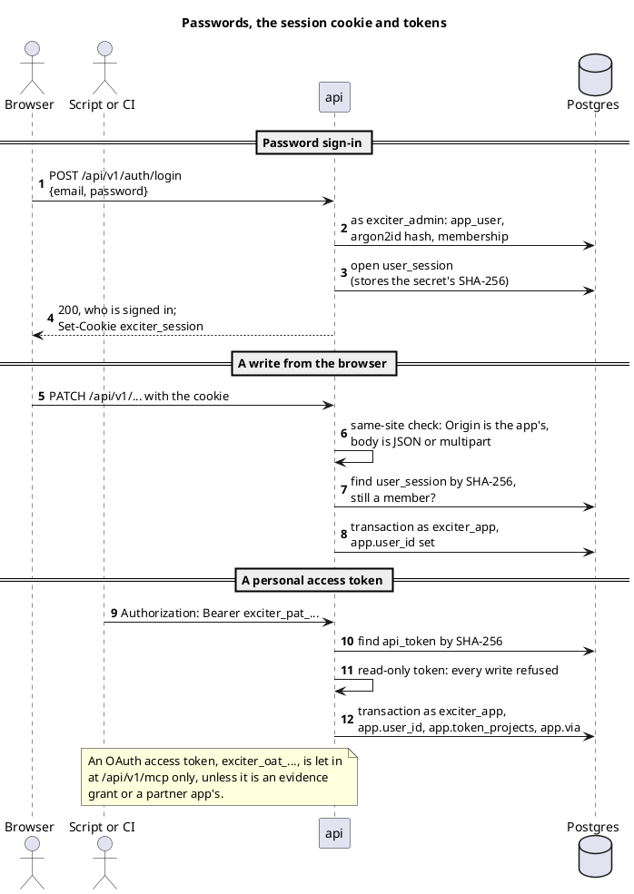
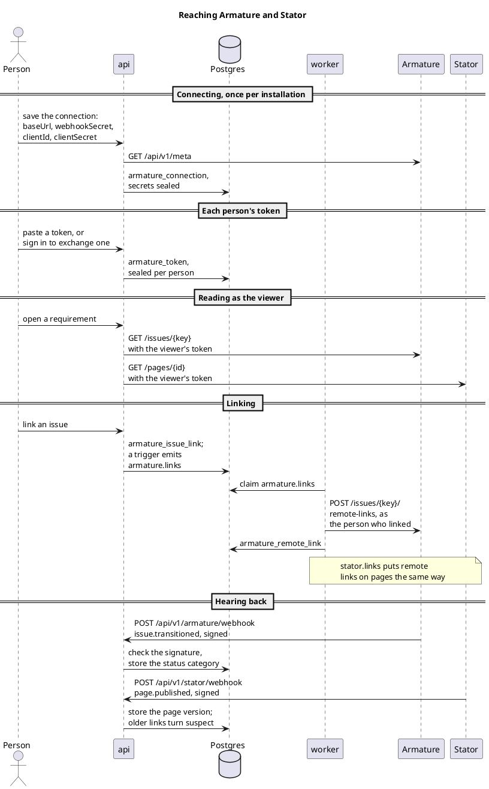
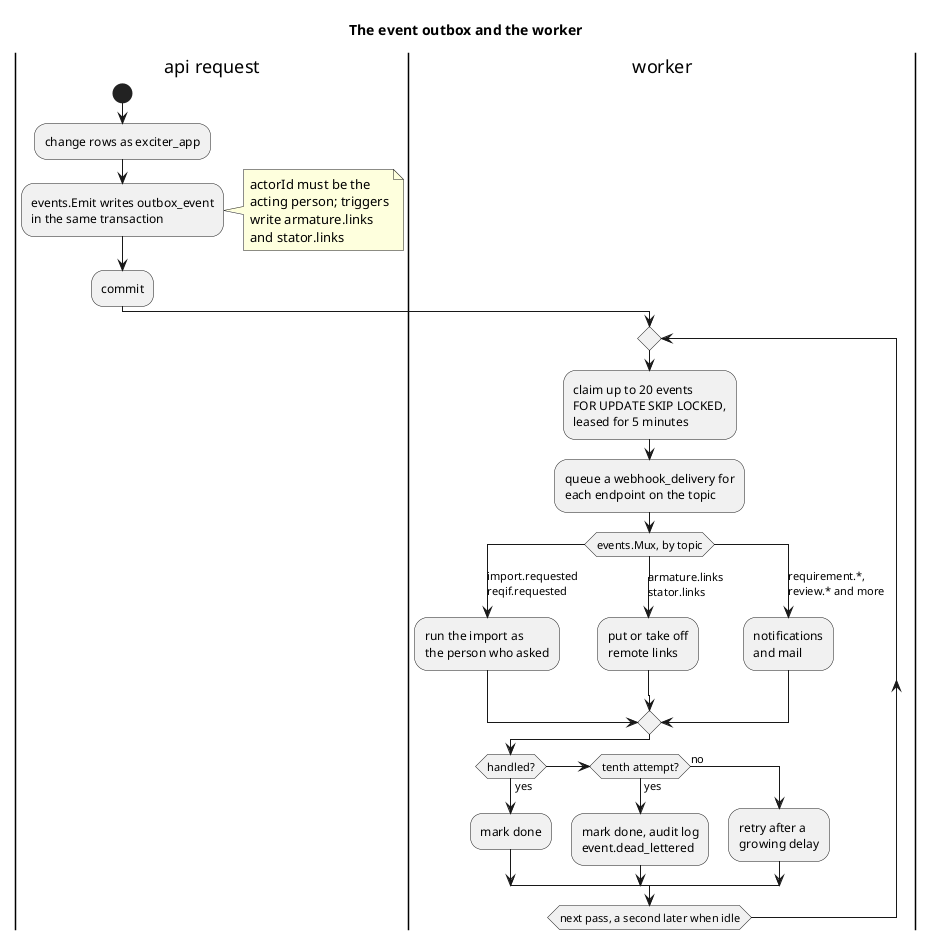
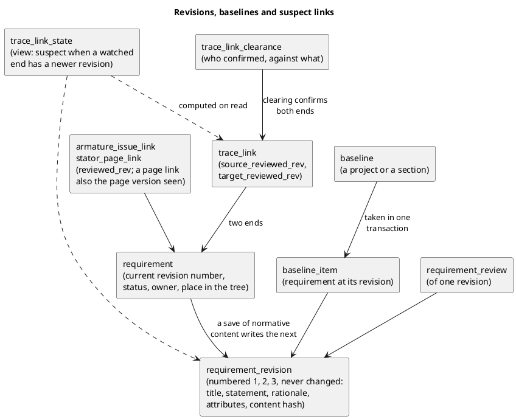
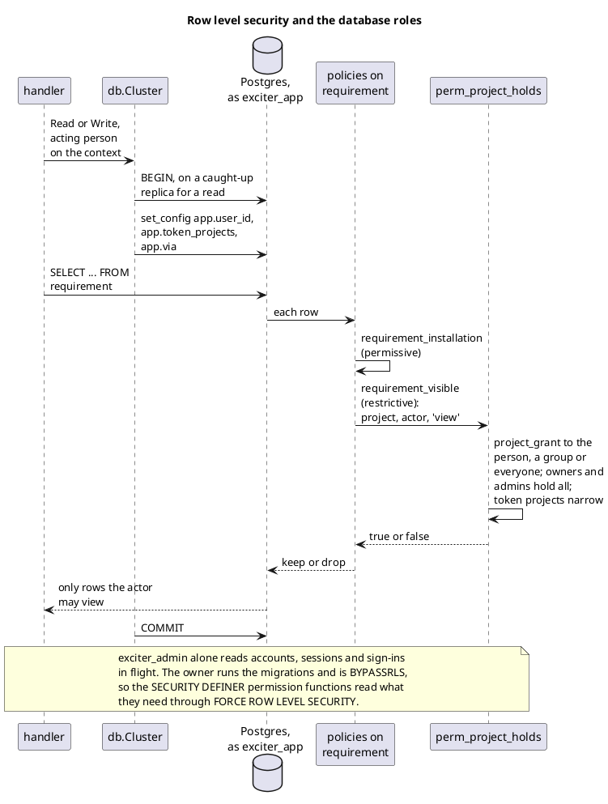

commit: b4e13d03c9a3783475defb946576743738e29d43
source: docs/architecture.md

How Exciter is built, drawn from its architecture document, its compose file and Helm chart, and the code behind them. Each view below is one part: the processes and stores, how they are deployed, how people sign in, how Exciter reaches Armature and Stator, and the outbox, revisions and row level security underneath.

## Components and data stores

The browser loads the React web client from nginx, which proxies `/api` to the Go api, so the browser sees one origin. The api writes to the Postgres primary and reads from a streaming replica once it has caught up, keeps read-your-writes positions and per-token caches of Armature and Stator answers in Valkey, and keeps attachments and theme files in an S3 bucket. Two sidecars only the api reaches do the heavy drawing: `render`, a headless Chromium that prints the web client's print view as PDF, and `kroki`, which draws PlantUML in its secure mode. The worker drains the outbox, sends mail, removes files whose rows are gone and puts remote links on Armature issues and Stator pages.

## Deployment with the Helm chart

Outside development Exciter runs from the chart in `deploy/charts/exciter`: Deployments for web, api, worker, kroki and, once `render.enabled` is set, render, with only the Ingress published. The Ingress sends `/api` and the OAuth metadata under `/.well-known/` to the api and everything else to web; hook Jobs make the secrets and database roles, run the migrations as the owner, and bootstrap the installation. Postgres comes from CloudNativePG or your own, Valkey and S3 from your own, each bundled for a trial. In development the same images run under Docker Compose, every port bound to `127.0.0.1`, with Keycloak, Mailpit and SeaweedFS beside them, and kroki and render publishing none.

## Signing in through the identity provider

Single sign-on is the authorization code flow with PKCE against the installation's one OIDC provider, in development Keycloak's realm `dynamo`, shared with Armature and Stator so a person is one subject in all three. The state, nonce and verifier wait in `oidc_login` and are taken once; the person is matched by issuer and subject in `user_identity`. When token exchange is switched on, the api trades the Keycloak access token for the person's tokens at Armature and Stator before the browser lands, and a failed exchange never fails the sign-in. The session lives in the http-only cookie `exciter_session`, Secure outside local development, and the database keeps only its SHA-256.

## Passwords, the session cookie and tokens

A local account signs in with its password, checked against an argon2id hash, and gets the same `exciter_session` cookie as single sign-on. There is no CSRF token: a write that rides on the cookie must come from the app's own origin and carry JSON or multipart, which a cross-site form cannot send. A script or pipeline sends a personal access token, `exciter_pat_` and 43 characters, as a bearer; it acts as its owner, a read-only one is refused every write before any handler, and one limited to projects carries them into every transaction.

## Reaching Armature and Stator

Exciter holds one connection to each partner, its address, the webhook secret the partner showed and, for token exchange, Exciter's client id and secret there, all sealed with `EXCITER_SECRET_KEY`; each person's token is sealed for that person alone. Every read of an issue or a page is made with the viewer's own token, through the outbound guard, so Exciter shows only what the partner would show them. Links go out through the outbox: a trigger emits `armature.links` or `stator.links`, and the worker puts the remote links as the person who made the change. The partners' signed webhooks come back to `/api/v1/armature/webhook` and `/api/v1/stator/webhook` and keep issue statuses and page versions current.

## The event outbox and the worker

A change and the events it causes commit together: `events.Emit` writes `outbox_event` in the caller's transaction, and the app role may insert only events whose actor is the person it acts for. Any number of workers claim events with `FOR UPDATE SKIP LOCKED`, queue outbound webhook deliveries first, then route each topic through `events.Mux` to its handler, which must be safe to run twice. A failure is retried after a growing delay, and the tenth leaves an `event.dead_lettered` entry in the audit log so one bad event never blocks the rest.

## Revisions, baselines and suspect links

A save that changes a requirement's normative content writes the next numbered, immutable revision; status, owner, labels and position are logged but never revisioned. Reviews, baselines and links all point at revision numbers, so a baseline is the list of revisions as one transaction found them. A trace link remembers the revision of each end it was confirmed against and turns suspect, computed on read in `trace_link_state`, when an end its type watches has a newer one; clearing confirms it again and is recorded for good.

## Row level security and the database roles

Every table forces row level security, and the api's requests run as `exciter_app` with the acting person, the token's projects and the token itself set in the transaction. A permissive policy per table lets the role in, and restrictive policies built on SQL functions such as `perm_project_holds` are the walls, so a guard holds even for a query that forgot it, and a test proves a guard by trying the same thing in SQL. `exciter_admin` alone reaches accounts and sessions, and the owner that runs the migrations is `BYPASSRLS`.

