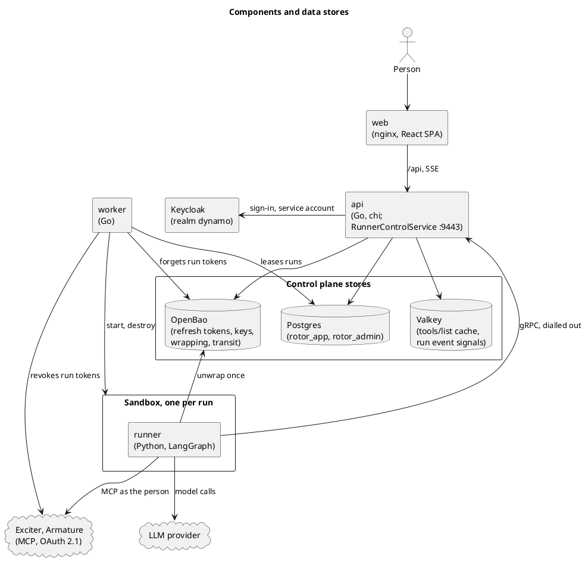
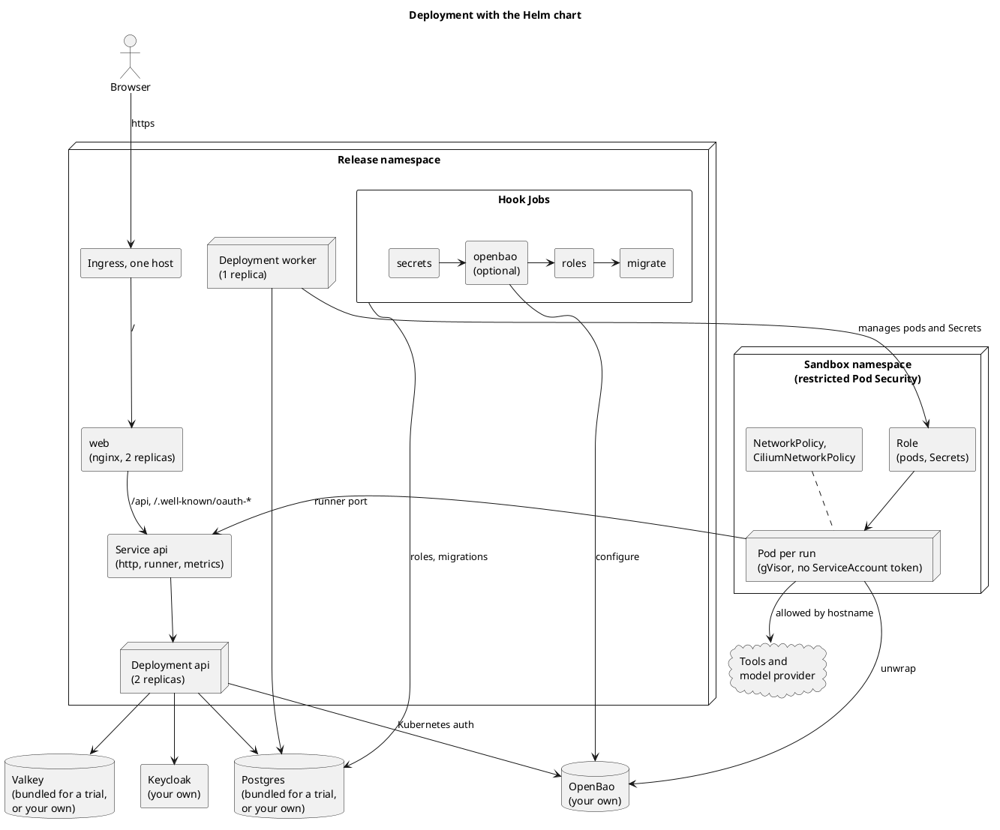
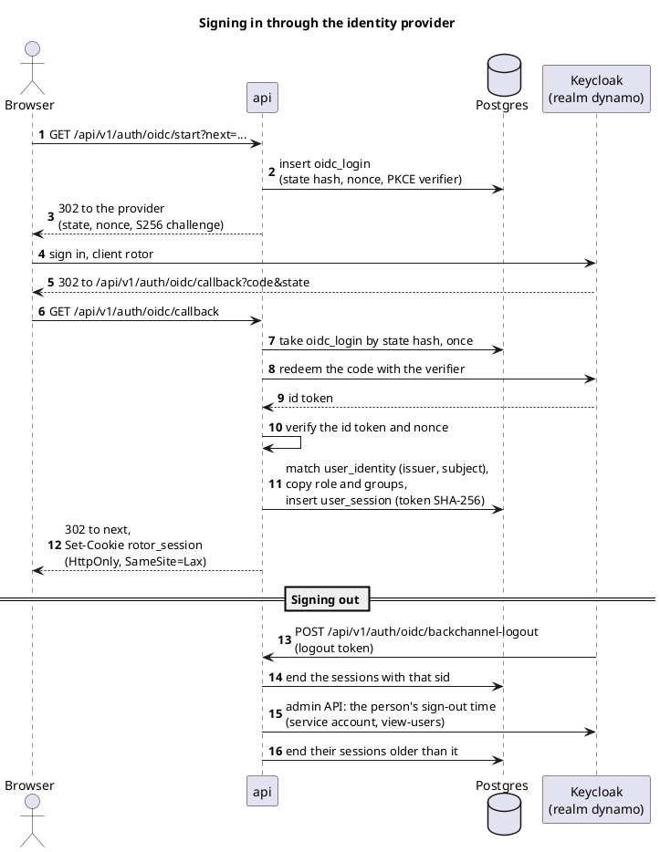
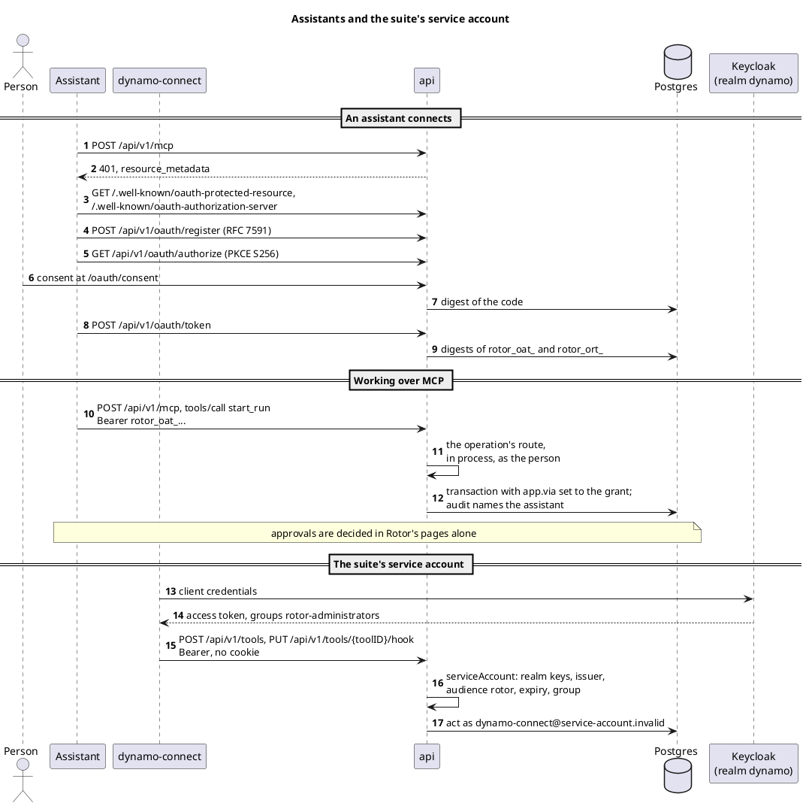
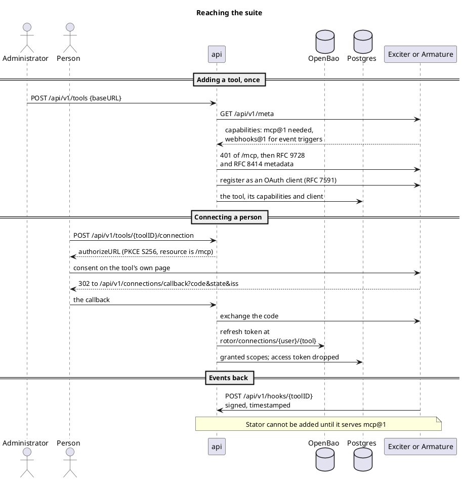
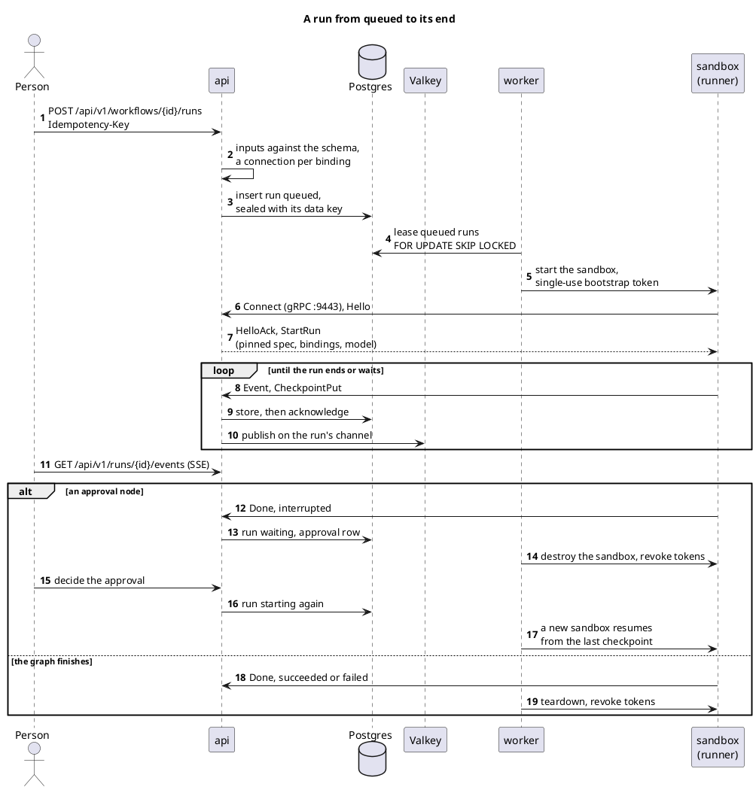
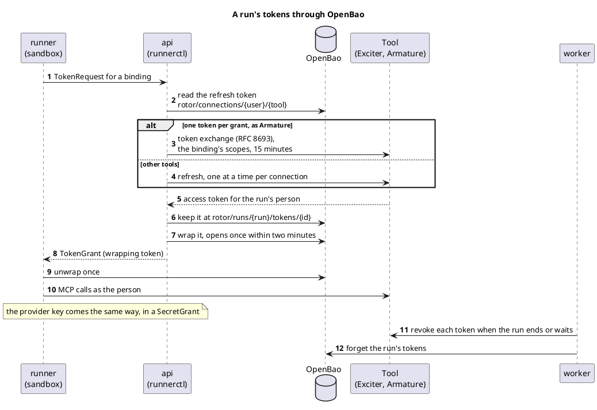
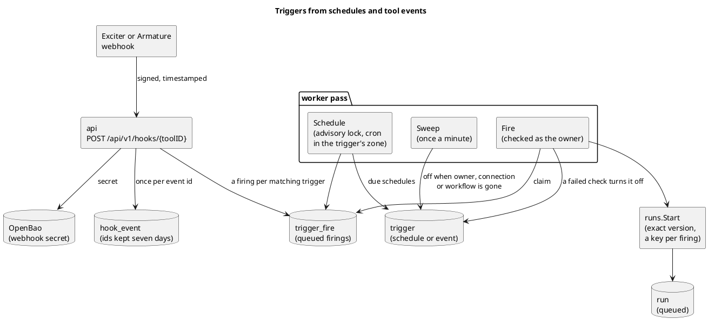

commit: 46af61fd9158c40da70617e8510d82defa4514df
source: docs/architecture.md

How Rotor is built, drawn from its architecture document, its decisions, its integration and trigger documents, the
compose file and Helm chart, and the code at this commit. Rotor has not released yet. Each view below is one part:
the processes and stores, how they are deployed, how people sign in, how assistants and the suite's service account
call the api, how Rotor reaches the tools, how a run goes from queued to its end in a sandbox, how a run gets its
tokens, and the triggers that start runs.

## Components and data stores

The browser loads the React web client from nginx, which proxies `/api` and the OAuth `.well-known` documents to the
Go api, so the browser sees one origin and follows a run's events as server-sent events. The api and the worker are
the trusted control plane: they keep workflows, runs, checkpoints and the audit log in Postgres under row level
security, use Valkey for the tools' cached `tools/list` and the signals that wake a run's event stream or carry a
cancel, and keep every long-lived secret in OpenBao: refresh tokens, provider keys, webhook secrets and the transit
key that wraps each run's data key. The worker starts one sandbox per run; the runner in it, Python and LangGraph,
dials the api over gRPC and calls the tools' MCP endpoints and the model provider as the run's person.

## Deployment with the Helm chart

The chart `deploy/charts/rotor` installs the api, the worker and the web, at their defaults two, one and two
replicas, and runs the secrets, OpenBao, roles and migrate hook Jobs before every upgrade. The Ingress sends
everything to the web, whose nginx proxies `/api` to the api on the same origin. The chart makes the sandbox
namespace, under the restricted Pod Security standard, with a token-less ServiceAccount and a Role that lets the
worker manage pods and Secrets there and nothing else. Sandboxes run under the gVisor RuntimeClass, dial the api's
Service on its runner port, and leave only by a NetworkPolicy that allows DNS, the runner port and OpenBao, with
Cilium allowing the tools and the provider by hostname. Postgres and Valkey are the installer's or bundled for a
trial; OpenBao and Keycloak are the installer's. In development `deploy/docker-compose.yml` runs the same images, and
the worker starts sandboxes on the host's Docker daemon on the internal network `sandbox`.

## Signing in through the identity provider

Sign-in is the authorization code flow with PKCE against the realm `dynamo`, client `rotor`, so a person is one
subject across the suite. `oidc_login` keeps the SHA-256 of the state with the nonce, the verifier and where to go
next, good for one callback. The callback matches the person in `user_identity` by issuer and subject and copies
their realm groups, where `rotor-administrators` makes an administrator; the session is a `user_session` row holding
the SHA-256 of an opaque token sent as the HttpOnly cookie `rotor_session`. Keycloak's back-channel logout reaches
`/api/v1/auth/oidc/backchannel-logout` and ends the matching sessions, and after a sign-out from everywhere Rotor
reads the person's sign-out time from Keycloak's admin API and ends their older sessions.

## Assistants and the suite's service account

Rotor is also an OAuth authorization server for its own MCP endpoint, `/api/v1/mcp` (`internal/oauth`, adapted from
Exciter's). An assistant registers by RFC 7591 or names a client ID metadata document, its person consents at
`/oauth/consent`, and it gets a `rotor_oat_` access token for MCP alone; Postgres keeps only digests of codes and
tokens. Each MCP tool is a row of the operations table, run in process through the router with the assistant's
token, so it does what its HTTP call does as the person; the transaction's `app.via` names the grant, the audit log
names the assistant, and an approval decided through one is refused. A bearer token that is not Rotor's own is let
in only on the four routes marked `serviceAccount`, where the suite's `dynamo-connect` adds tools and hands over
their webhook secrets with a realm access token that carries `rotor-administrators`.

## Reaching the suite

Rotor is an OAuth 2.1 client of each tool and calls nothing of theirs but `/meta`, their OAuth endpoints and their
MCP endpoints, as the person. An administrator adds a tool by its address: Rotor reads its `/meta` and adds it only
with `mcp@1`, discovers the MCP endpoint's authorization server (RFC 9728, RFC 8414) and registers as its client (RFC
7591). A person connects on the tool's own consent page; the callback checks the state and the issuer, keeps the
refresh token in OpenBao at `rotor/connections/{user}/{tool}` and the granted scopes in Postgres, and drops the
access token. Exciter connects as it is; Armature once one of its administrators allows Rotor's client, and with
every run's token exchanged from the grant's. Stator cannot be added until it serves `mcp@1`. The other way, a tool
with `webhooks@1` sends signed deliveries to `/api/v1/hooks/{toolID}`, and Rotor lists `workflows@1`, `runs@1`,
`hooks@1` and `mcp@1` at its own `/meta` for the suite.

## A run from queued to its end

A person starts a run with `POST /workflows/{id}/runs`: the inputs are checked against the workflow's schema, each
binding needs the person's connection with the scopes it asks for, and the run is inserted `queued`, sealed with a
data key of its own. Any number of workers lease runs with `FOR UPDATE SKIP LOCKED` and make each pass in order:
reconcile the stack's sandboxes, expire what waited or went silent, queue what triggers fired, start each queued run
in a sandbox with a single-use bootstrap token, and tear down after runs that ended. The runner dials
`RunnerControlService`, says `Hello`, gets `StartRun` with the pinned workflow and its model, compiles it into a
LangGraph graph and streams events and checkpoints back, each stored before it is acknowledged; the api publishes
`runevents:<run>` on Valkey so any api replica can stream the run to the browser. An approval node leaves the run
`waiting` and the worker drops its sandbox and tokens; a decision sends it back to `starting`, and a new sandbox
resumes from the last checkpoint.

## A run's tokens through OpenBao

A sandbox holds no refresh token and no OpenBao credential, and never sees a token in clear on the wire. When the
runner asks for a binding's token, the api mints one as the run's person from the connection's refresh token, one
refresh per connection at a time; for a tool that keeps one access token per grant, as Armature does, it exchanges
the grant's token for one narrowed to the binding's scopes, for 15 minutes (RFC 8693). It keeps the token at
`rotor/runs/{run}/tokens/{id}` and sends a `TokenGrant` holding an OpenBao wrapping token that opens once within two
minutes; the runner unwraps it at OpenBao itself, and the model provider's key comes the same way as a `SecretGrant`.
Tokens live in the runner's memory alone and are cut from its events; when the run ends or waits, the worker revokes
each one at its tool and forgets it.

## Triggers from schedules and tool events

A trigger is a record a person makes on a workflow they may see; it starts the workflow's current version as its
owner, on a schedule or when a tool delivers a matching event. A delivery to `/api/v1/hooks/{toolID}` must carry the
tool's timestamped HMAC-SHA256 signature, at most five minutes old, made with the secret kept in OpenBao; its event
id goes into `hook_event` so a repeat starts nothing, and each enabled event trigger whose topics, projects and
conditions match gets a `trigger_fire` row in the same transaction. The worker sweeps off, once a minute, the
triggers whose owner, connection or workflow is gone, and on every pass turns due schedules into firings under an advisory lock, checks every
firing again as the trigger's owner and calls `runs.Start` with the exact version it checked and a key per firing,
so a firing never starts two runs. A failed check turns the trigger off with a reason the owner reads.

