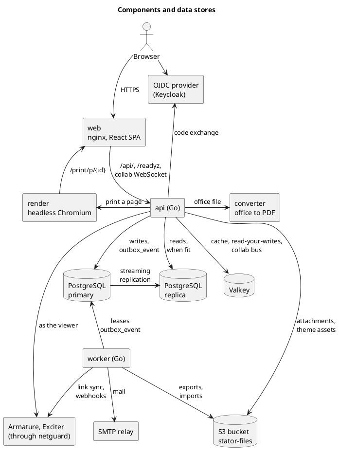
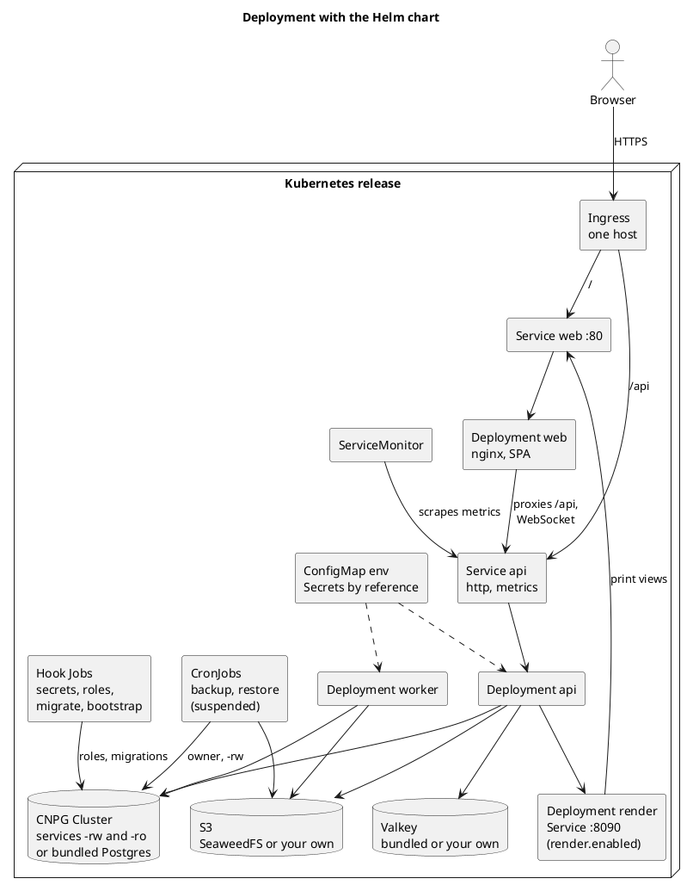
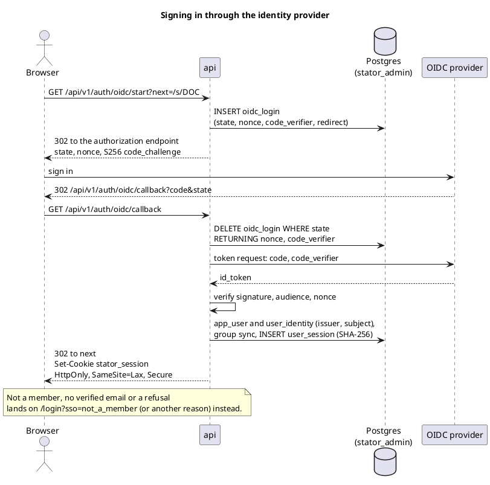
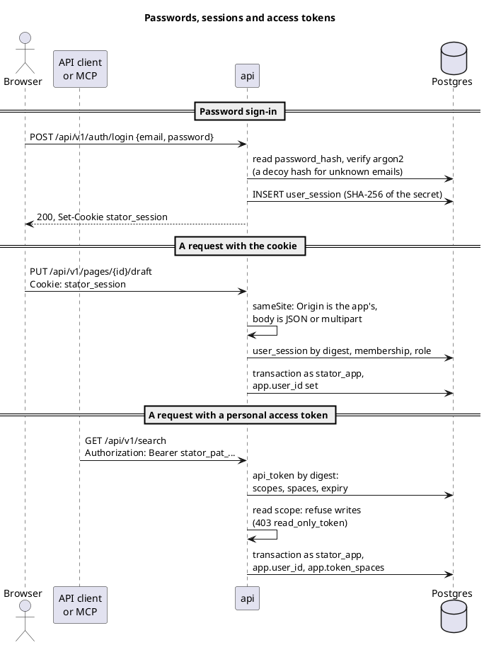
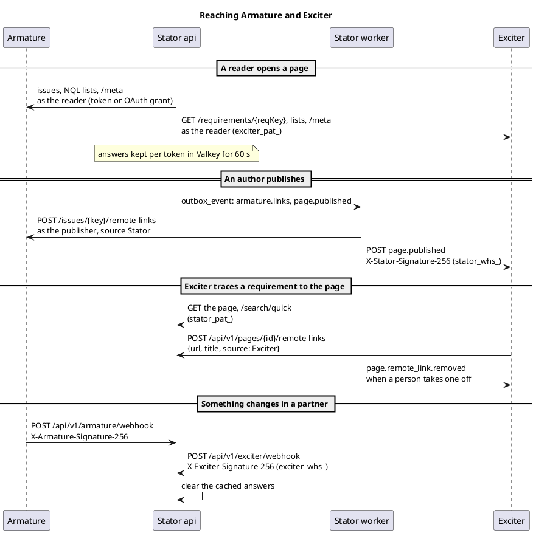
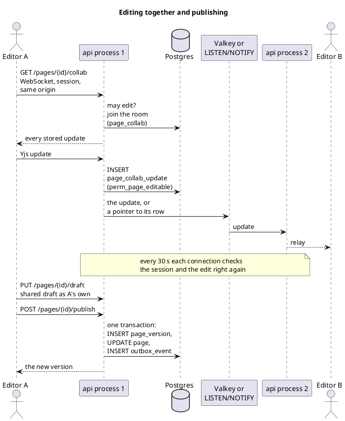
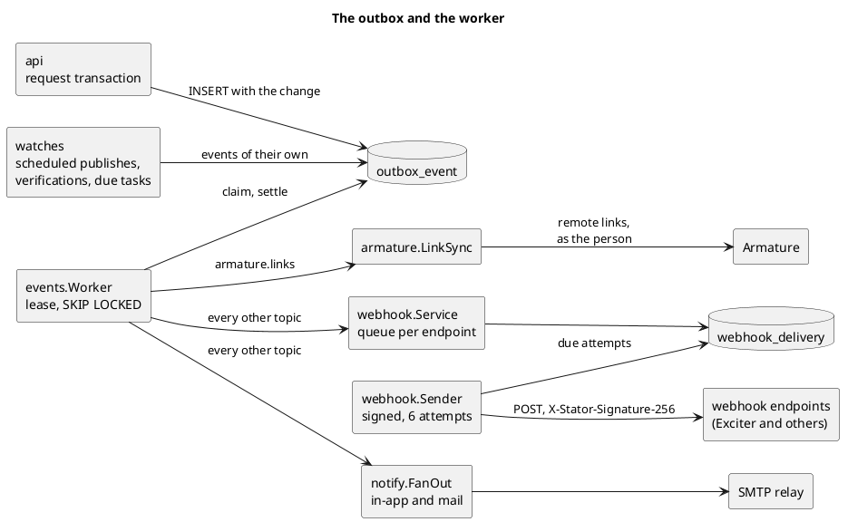
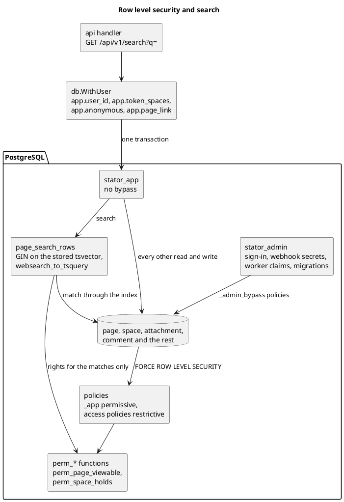

commit: 6094b76162be38a0ec13e12c00cd6a37b22219c9
source: docs/architecture.md

How Stator, the suite's wiki, is built, drawn from its architecture document and checked against its compose
file, Helm chart and backend code at the commit above.

## Components and data stores

Stator is a React single page app served by nginx, one Go `api` and one Go `worker`, both built from the same
backend image. The api writes to the Postgres primary and reads from a replica whenever that replica has replayed
the caller's last write; Valkey holds caches, read-your-writes positions and the bus between api processes, and
every file lives in S3-compatible storage. Two sidecars are reached by the api alone: `converter` turns office
documents into PDF previews, and `render` prints a page's print view to PDF by opening it in the web container.

## Deployment with the Helm chart

`deploy/charts/stator` runs the api, the worker and the web behind one Ingress host: `/api` goes straight to the
api Service and everything else to the web Service, so the session cookie stays first-party. Hook Jobs make the
passwords, the two database roles and the schema before the workloads start; the database is a CloudNativePG
`Cluster` (`-rw` for writes, `-ro` across replicas) or, for a trial, the chart's own Postgres and Valkey pods. In
the compose stack every service publishes only on `127.0.0.1`, and `converter` and `render` publish nothing.

## Signing in through the identity provider

An instance serves one organization, and its OIDC provider is configured in the database, not in the environment.
Signing in is the authorization code flow with PKCE: the api keeps the state, nonce and code verifier in
`oidc_login` for fifteen minutes, verifies the ID token and its nonce, makes or finds the person by issuer and
subject, syncs their groups and opens a session. The browser only ever holds the `stator_session` cookie, which
the database keeps as a SHA-256 digest.

## Passwords, sessions and access tokens

A local account signs in with `POST /api/v1/auth/login`, checked against an argon2 hash, and gets the same session
cookie. Every request then presents one credential: `Authorization: Bearer` wins over the cookie, a secret starting
`stator_pat_` is looked up in `api_token` and anything else in `user_session`, both by digest. Writes that ride on
the cookie are held to the site's origins and to JSON or multipart bodies instead of a CSRF token, and a token made
with the `read` scope is refused every write.

## Reaching Armature and Exciter

Stator calls each partner as the viewing person, with that person's own token sealed under `STATOR_SECRET_KEY`
(an Armature personal access token or OAuth grant, an `exciter_pat_` token), so a page never shows an issue or a
requirement its reader could not open; answers are kept per token in Valkey and a signed webhook from the partner
clears them. On publish the worker puts a remote link on every Armature issue the page names. Exciter in turn
reads pages, puts its requirements on them as remote links with a `stator_pat_` token, and hears through Stator's
signed webhooks, whose `stator_whs_` secret an administrator pastes into Exciter.

## Editing together and publishing

Everybody with a page's editor open edits one shared draft, a Yjs document passed over a WebSocket in
y-protocols' framing; the api stores each update and relays it without reading it, and a second api process hears
of it through Valkey or, without Valkey, Postgres's LISTEN and NOTIFY. Publishing is still each person's own: the
shared draft is saved into their `page_draft`, and the publish writes a `page_version`, copies it onto `page` and
queues its events in one transaction, so history, diff and restore read `page_version`.

## The outbox and the worker

Anything that must happen after a change, from mail to Armature's links and outbound webhooks, is an
`outbox_event` row committed with the change. Any number of workers lease batches of events with
`FOR UPDATE SKIP LOCKED`, so delivery is at least once and a worker that dies only delays its lease. Webhook
deliveries are queued per endpoint and sent by a loop of their own, each payload read as the endpoint's owner at
send time and retried six times; the worker also runs the watches for scheduled publishes, lapsed verifications,
due tasks, example spaces, imports and exports.

## Row level security and search

The database itself decides who reaches which rows. The api and the worker connect as `stator_app`, which cannot
bypass row level security, and each transaction names its person in `app.user_id` (and, when they apply, a token's
spaces, an anonymous reader or a public link); every table has a permissive `_app` policy narrowed by restrictive
policies built on the same `perm_*` functions the services call. Search uses a stored `tsvector` with a GIN index:
hit functions match through the index first and apply the viewers' rules to the matches only.

